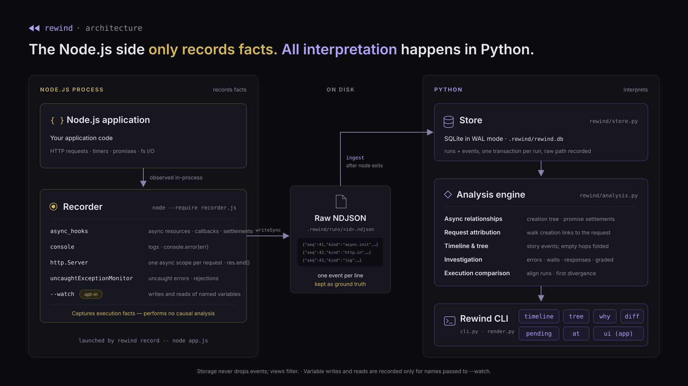

<h1 align="center">◂◂ Rewind</h1>

<p align="center">
  <strong>Postmortem debugging for Node.js applications.</strong><br/>
  Record a run once, then ask <em>why</em> something happened, not just <em>what</em> broke.
</p>

A stack trace tells you where an exception surfaced. Rewind reconstructs the execution history around it:
- which request the failing work belonged to
- which callback scheduled it, and from where
- what other requests were doing at the same time
- who last changed the state it used
- where a failing run first diverged from a good one

Every statement Rewind makes is labelled as **observed**, **derived** or **inferred**, so you always know how much
to trust it.

## Quick links

| | |
|---|---|
| **Main repository** | [github.com/dangerousEnigma1827/Rewind](https://github.com/dangerousEnigma1827/Rewind) |
| **Judge-facing demo** (reproduce the Phantom Discount bug step by step) | [github.com/dangerousEnigma1827/rewind-demo-test](https://github.com/dangerousEnigma1827/rewind-demo-test) |
| **Website source** | [github.com/dangerousEnigma1827/rewind-cli](https://github.com/dangerousEnigma1827/rewind-cli) |
| **Website** | [rewind-cli.vercel.app](https://rewind-cli.vercel.app/) |

---

## The problem

In asynchronous Node.js, one request's work is spread across timers, file reads, promises and callbacks. When
several requests run at once, their callbacks interleave. If they share mutable state, one request can silently
read another's data.

These bugs are hard to debug:
- **The stack trace stops at the callback boundary.** It shows the timer callback that threw, not the request that
  scheduled it.
- **The cause is often somewhere else.** A different request wrote the bad value, earlier, at a different line.
- **They depend on timing.** Run the same requests one at a time and the bug disappears. Add logging and the timing
  changes.
- **Some never throw at all.** A wrong total is just a log line.

Rewind records the causal structure of a run, so you can investigate it after the fact without re-running it under
a debugger.

---

## How Rewind works

<p align="center">
  
</p>

**The Node.js side only records facts. All interpretation happens in Python.**

1. **Record.** `rewind record -- node app.js` starts your program with a recorder preloaded
   (`node --require recorder/recorder.js`). You don't change any code. The recorder uses:
   - `async_hooks` to note every async resource: which one triggered it, and where in your code it was created;
   - `console` to capture logs;
   - Node's `http` server, so each request gets its own scope (keep-alive included);
   - `uncaughtExceptionMonitor` to capture errors without changing crash behaviour or exit codes.

   With `--watch VAR`, it also records writes to chosen module-level variables.
2. **Store.** Events are written synchronously as NDJSON, one per line, to `.rewind/runs/<id>.ndjson`, and the file
   is kept as ground truth. When the program exits, Python ingests it into SQLite (`.rewind/rewind.db`, WAL mode),
   along with a snapshot of your source files, checked against hashes taken as Node loaded them. Editing the code
   afterwards doesn't change what `why` quotes from an old run.
3. **Analyse.** Pure Python functions rebuild the async tree from trigger ids and attribute every event to its HTTP
   request. On top of that, they build the timeline and tree, investigate errors (`why`), and align two runs (`diff`).
4. **Present.** A Typer + Rich CLI renders the results for terminals of any width, with or without colour.

More detail: [docs/ARCHITECTURE.md](docs/ARCHITECTURE.md). Each design decision was validated by an experiment
first: [spikes/RESULTS.md](spikes/RESULTS.md).

---

## Key capabilities

| capability | command | what you get |
|---|---|---|
| **Execution timeline** | `rewind timeline` | requests, logs, watched writes and errors in order, each tagged with its request; filter by request or event kind |
| **Causal tree** | `rewind tree` | who scheduled whom, with creation sites; quiet branches pruned and internal hops folded (`--full` shows everything) |
| **`why` analysis** | `rewind why` | for an error, or any event by `--seq`: throw site, causal chain back to the request, overlapping requests, and watched-state writes |
| **Exception correlation** | `rewind why` | uncaught exceptions and unhandled promise rejections (including after `await`) tied back to the callback and request that caused them |
| **Variable watching** | `rewind record --watch VAR` | every syntactic write to a watched top-level CommonJS variable: location, the request that made it, before/after values |
| **Execution comparison** | `rewind diff A B` | aligns two runs and reports the first divergence, and whether a step moved (different interleaving) or is new (different code path) |

### Evidence levels

| | level | meaning |
|---|---|---|
| `●` | **observed** | a recorded event, reported as-is |
| `◆` | **derived** | computed deterministically from recorded events (ancestry, ordering, attribution) |
| `?` | **inferred** | a heuristic explanation, always citing the observed/derived evidence behind it |

`--evidence` prints the event sequence numbers behind every finding.

Rewind won't claim what it didn't see:
- **Without `--watch`, it claims no writes.** It only says shared state is suspected.
- **Reads are never recorded,** so a conclusion that relies on one is always marked inferred.

---

## The Phantom Discount demo

`demo/checkout.js` is a small order service with a deliberate bug. The cart for the current order lives in **one
module-level variable shared by every request**:
- `loadCart` writes it.
- `chargePayment` waits on a timer that stands in for a payment gateway.
- After the wait, `applyDiscount` adds up the cart's prices.

`demo/traffic.js` sends a `GET /health` warm-up, then three overlapping orders. Requests are numbered in arrival
order, so the orders are **#2, #3 and #4**.

| request | order | correct total | what happens |
|---|---|---|---|
| #2 | A-101 | $128 | charged **$161**: request #3 replaced the cart before A-101's payment finished. No error is raised. |
| #3 | B-202 | $186 | **crashes** with `TypeError: Cannot read properties of undefined (reading 'price')`: request #4 replaced the cart with a one-item cart |
| #4 | C-303 | $11 | correct |

Plain Node shows only the crash in a timer callback at `checkout.js:23`. It doesn't say which order failed, who
changed the cart, or that $161 is wrong. `rewind why` does:

```text
  ● thrown in applyDiscount at demo/checkout.js:23
  ◆ causal chain: Timeout paymentConfirmed from chargePayment (demo/checkout.js:18) ← FSREQCALLBACK
    from loadCart (demo/checkout.js:9) ← request #3 POST /order
  ◆ request #4 POST /order was active while #3 POST /order was in flight (arrived, logged,
    responded, wrote state)
  ● last write to `currentCart` before this point: `currentCart` = at demo/checkout.js:12:5, new
    value {"order":"C-303","items":[{"sku":"cable-03","price":12}]}
  ◆ that write was made by request #4 POST /order
  ◆ #3 POST /order set `currentCart` itself (seq 254); request #4 overwrote it (seq 371) before
    this point (seq 430)
  ? likely root cause: a race on shared module-level state. …
```

*(An excerpt from one real run. Run ids, `seq` numbers and event counts differ between runs.)*

Two more views complete the story:
- `rewind why --seq` explains the silent $161 overcharge, and says "Reads are not recorded, so this is not proven."
- `rewind diff good bad` against a sequential run shows the same code path with a different interleaving.

`demo/fix.patch` keeps the cart per request. With it applied, all three totals are correct and `rewind why`
reports no errors.

**➜ To reproduce it yourself, use the judge-facing repository
[rewind-demo-test](https://github.com/dangerousEnigma1827/rewind-demo-test).** It has Windows and Linux/macOS
instructions, an 8-step walkthrough, and real expected output.

---

## Quick start

### Prerequisites

- Python **3.12+**
- Node.js **20+** with npm
- Git

On Ubuntu/Debian the interpreter is `python3`, and `venv` needs the `python3-venv` package
(`sudo apt install python3-venv`).

### Install

```sh
git clone https://github.com/dangerousEnigma1827/Rewind.git
cd Rewind
python -m venv .venv
.venv/Scripts/activate        # Windows PowerShell   (Git Bash: source .venv/Scripts/activate; Linux/macOS: source .venv/bin/activate)
pip install -e ".[dev]"       # [dev] adds pytest; plain `pip install -e .` is enough to use Rewind
npm install --prefix recorder # needed for --watch
```

Install Rewind in **editable mode** (`-e`). The CLI loads the Node recorder from `recorder/`, next to its source
folder, and a regular `pip install` doesn't include it.

If PowerShell blocks the activation script, skip activation: run `.venv\Scripts\python -m pip install -e ".[dev]"`,
then call `.venv\Scripts\rewind.exe` directly.

### Record and inspect a run

```sh
rewind record -l bad -w currentCart -- node demo/traffic.js   # runs the program normally, recorded
rewind why bad                                                 # the causal story of the crash
rewind timeline bad                                            # what happened, in order
rewind record -l good -w currentCart -- node demo/traffic.js --sequential
rewind diff good bad                                           # where the two executions part ways
```

To record your own program: `rewind record -- node app.js [args]` (or just `rewind record app.js`). Running bare
`rewind` opens a landing screen with your recorded runs and the commands.

---

## CLI commands

| command | what it does |
|---|---|
| `rewind record [-l LABEL] [-w VAR,...] -- node app.js [args]` | runs the program with the recorder preloaded, stores the run, and passes the program's exit code through |
| `rewind runs` | lists recorded runs, newest first |
| `rewind timeline [RUN] [-r N] [-k KINDS] [-c] [--raw]` | the run's story; `-r` shows one request, `-k log,http,error,mutation,async,run` filters by kind, `-c` adds every user callback firing, `--raw` shows every recorded event |
| `rewind tree [RUN] [-r N] [--full]` | the async causality tree; `-r` roots it at a request |
| `rewind why [RUN] [-e N] [-s SEQ] [--evidence]` | investigates error N (default: the first), or any event by its seq |
| `rewind diff A B [--all] [--evidence]` | aligns two runs and finds the first divergence; `--all` includes callbacks outside any request |

`RUN` is a label, an id prefix, `last` (the default) or `-N` (the Nth newest). `rewind <command> --help` lists
every option.

### Configuration

| env | default | |
|---|---|---|
| `REWIND_HOME` | `./.rewind` | database (`rewind.db`) and raw NDJSON recordings (`runs/`) |
| `REWIND_PROMISE_STACKS` | `1` | `0` skips promise creation stacks: about 1.9× → 1.1× overhead on the benchmark below, but `async` function names are lost in chains |
| `REWIND_MUT_CAP` | `10000` | recorded writes per watched variable |
| `NO_COLOR` | unset | any value turns colour off; the layout and the ● ◆ ? marks stay. Piped output never has colour |

---

## Project structure

```
recorder/     Node.js side: recorder.js (async_hooks, console, http, errors, NDJSON output)
              and instrument.js (the --watch AST rewrite; acorn + magic-string, loaded only with --watch)
rewind/       Python side: store.py (SQLite ingest, run lookup), analysis.py (attribution, tree, why, diff),
              render.py (terminal output), cli.py (Typer commands)
demo/         the Phantom Discount demo: checkout.js, traffic.js, prices.json, fix.patch
tests/        pytest suite; most tests run real node processes end to end
spikes/       the feasibility experiments (E0–E7) behind each design decision, with results
docs/         ARCHITECTURE.md, assets/ (the architecture diagram), and handover/: status, engineering log, testing record
```

---

## Testing and verification

```sh
pytest        # 56 tests; most run real node processes end to end
```

| environment | result |
|---|---|
| Windows 11, Python 3.15.2, Node.js 24.22.1 | 56 / 56 passed |
| Ubuntu 24.04 on WSL2, Python 3.12.3, Node.js 24.22.2 | 56 / 56 passed |

Also checked:
- The 39 feasibility checks in `spikes/check.py` pass.
- The README install and the Phantom Discount walkthrough were reproduced from fresh clones.
- Real terminal output was checked in the classic Windows console, Windows Terminal and Linux tmux, at sizes
  down to 40×24 (the landing screen down to 30×12), with colour on and off.

**Not tested:** macOS; Linux outside WSL2; Python 3.13 and 3.14; Node.js 20 and 22. The full record is in
[docs/handover/TESTING_AND_VERIFICATION.md](docs/handover/TESTING_AND_VERIFICATION.md).

---

## Limitations

Rewind records the **causal skeleton** of a run: async lifecycle, HTTP requests, logs, errors and watched writes.
It records execution facts as they happen and analyses them afterwards. It doesn't replay execution or step
backwards, doesn't capture every function call or variable value, can't set breakpoints, and has no web UI.

**What `--watch` sees.** `--watch currentCart` rewrites CommonJS files as they load, so every *syntactic* write to
a watched variable declared at the top level of that file is recorded. That covers:
- reassignment;
- property and element assignment, and compound operators;
- `++` / `--` and `delete`;
- calls to known mutating methods: `push pop shift unshift splice sort reverse fill copyWithin set delete clear add`.

**It does not see:**
- writes through aliases (`const c = currentCart; c.x = 1`);
- destructuring targets (`[currentCart.a] = v`);
- files under `node_modules`;
- ES modules (`.mjs`, `"type": "module"`);
- mutations made inside functions the value is passed to;
- same-named local variables (skipped on purpose);
- **reads**: never recorded.

So "this overwrite caused the failure" is always marked inferred. Values are JSON previews of up to 200
characters. A variable written more than `REWIND_MUT_CAP` times keeps counting, but its values stop being recorded.
The AST dependencies load only when `--watch` is used.

**Other limits:**
- HTTP attribution covers Node's `http` server, including keep-alive. `https`, `http2`, outgoing HTTP clients, worker
  threads and child processes are not instrumented. A child started with `fork()` or `cluster` loads the recorder but
  stays inert, so only the parent is recorded and its recording stays intact.
- Unhandled rejections are captured only in Node's default `--unhandled-rejections=throw` mode.
- A run killed with SIGKILL loses up to its last 256 events. Error events are flushed immediately, so they survive,
  and the run is marked `crashed`.
- Overhead: on a 300-request HTTP benchmark, recording cost about **1.9×** wall time with promise stacks (the
  default) and about **1.1×** without ([spikes/RESULTS.md](spikes/RESULTS.md), E6). That is one synthetic
  workload, not a general figure.
- The `why` root-cause line is a heuristic explanation for the shared-state pattern. It isn't a general
  root-cause engine.

---

## Technology stack

- **Recorder:** Node.js (`async_hooks`, `http`, `uncaughtExceptionMonitor`), with
  [acorn](https://github.com/acornjs/acorn), acorn-walk and [magic-string](https://github.com/Rich-Harris/magic-string)
  for `--watch`.
- **Storage:** newline-delimited JSON, ingested into SQLite (Python standard library, WAL mode).
- **Analysis and CLI:** Python 3.12+, [Typer](https://typer.tiangolo.com/), [Rich](https://github.com/Textualize/rich).
- **Tests:** [pytest](https://pytest.org/), driving real Node.js processes.

---

## License

Rewind is released under the [MIT License](LICENSE).

---

<p align="center">
  Built for <strong>CODEFESTTHON 2026</strong>
</p>
